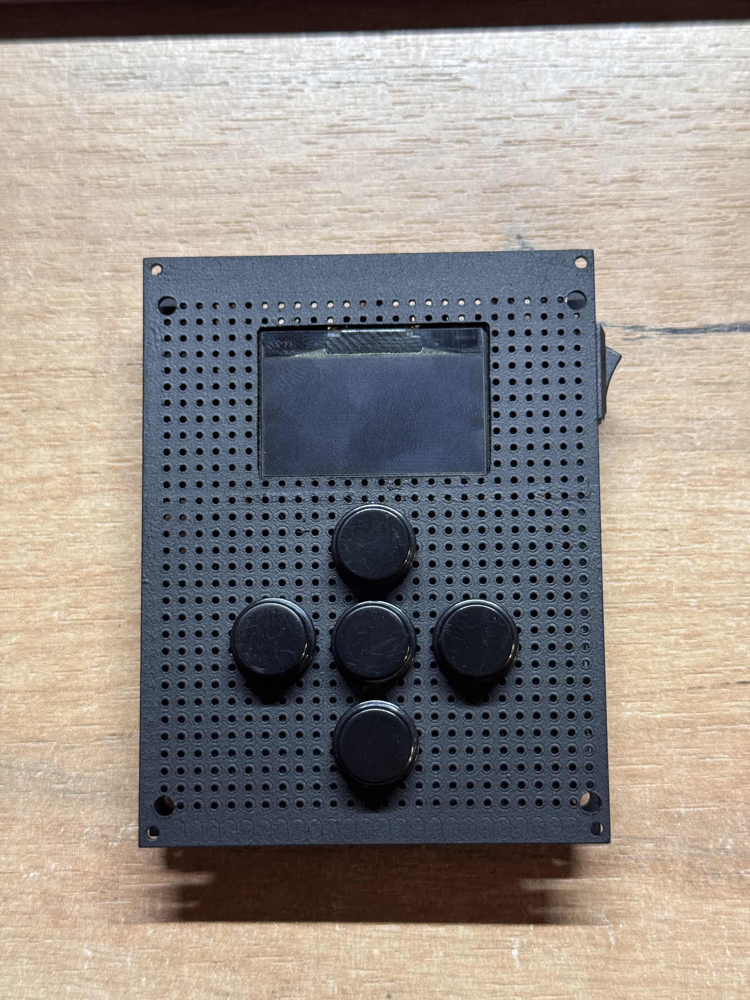
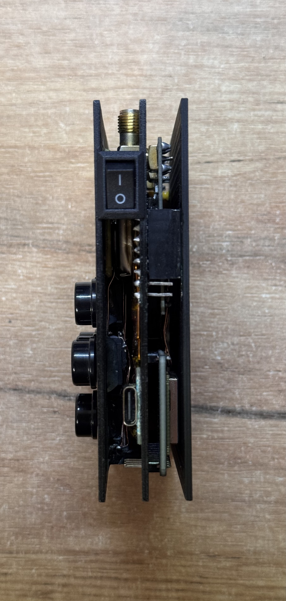
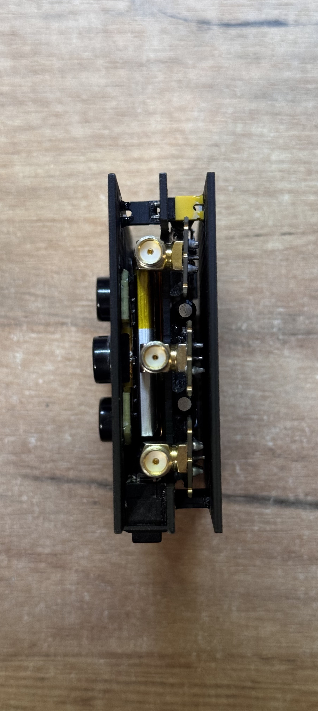
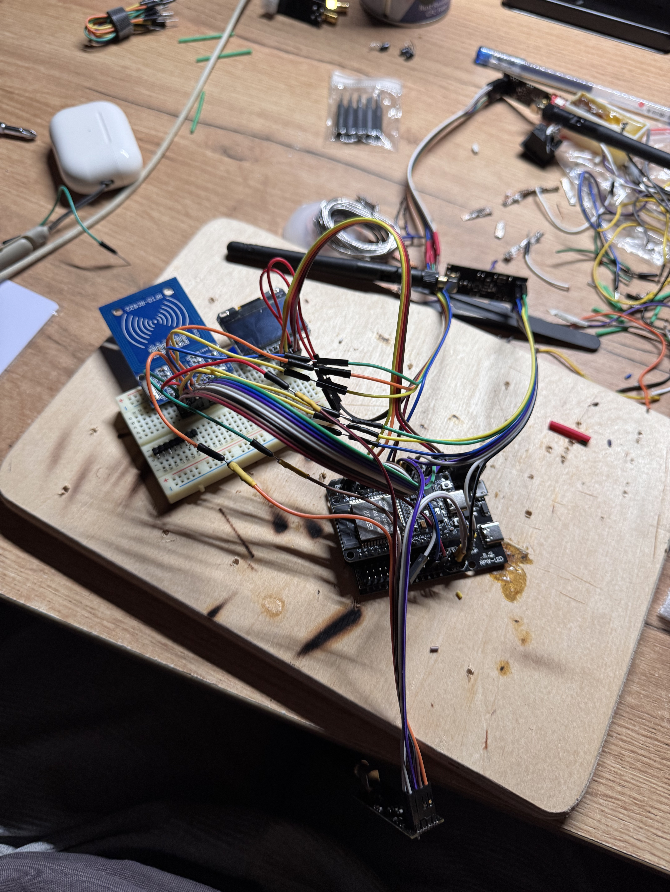
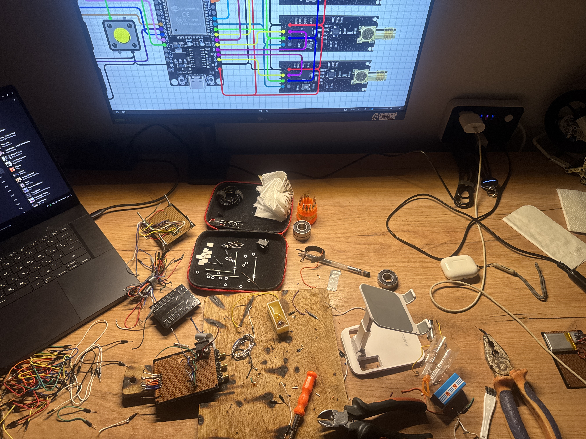
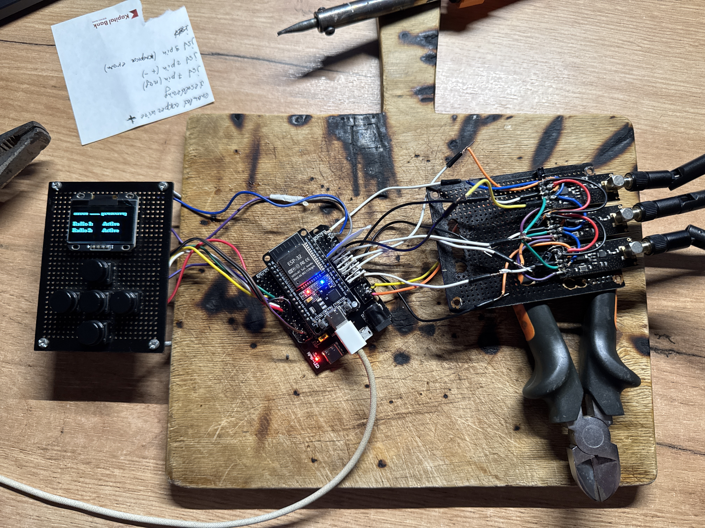
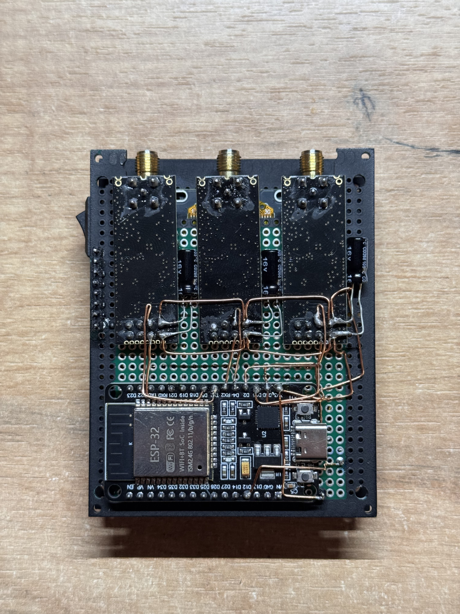
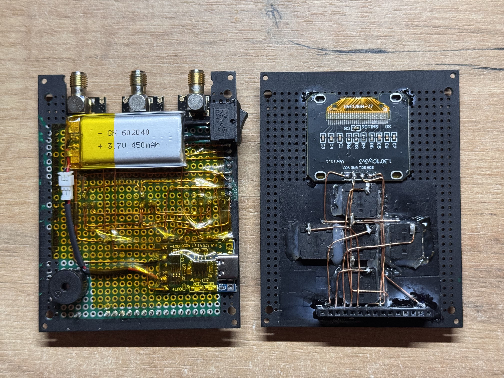
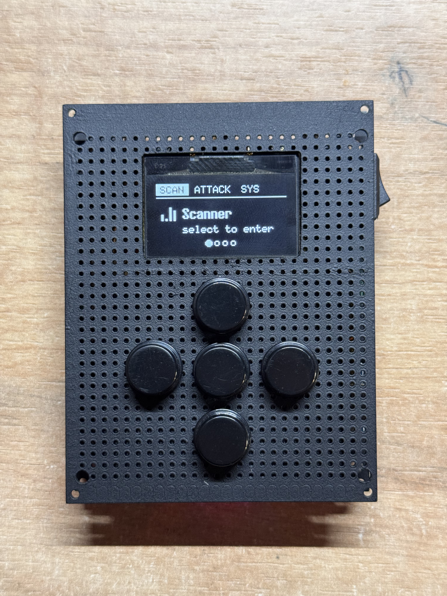
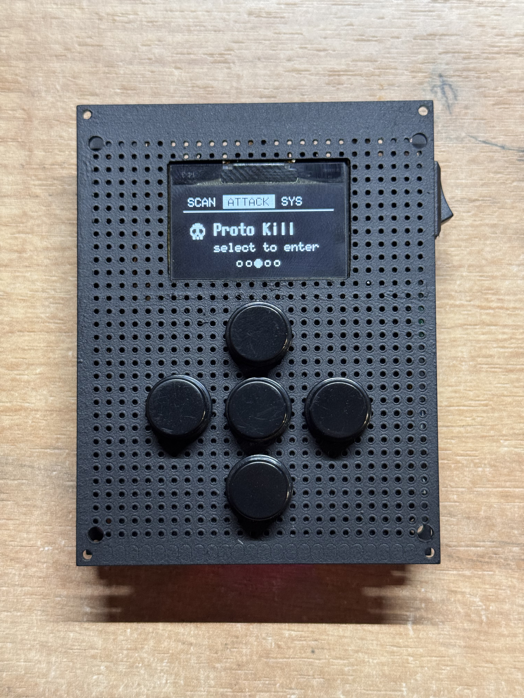

# 📡 JAMMER V2 — Wireless Security Research Device

A hands-on hardware and cybersecurity project. Built to understand wireless communication, RF interference, and the real-world attack surface of 2.4 GHz protocols — and how systems can be hardened against them.

  
  
  

---

## ⚠️ Legal Disclaimer

This device was built and tested **exclusively in isolated, controlled lab environments** with no third-party devices or networks affected at any time. Operating a signal jammer is **illegal in most jurisdictions** without explicit authorization. This project exists solely for **educational and defensive security research**. Do not replicate or operate it outside of a properly shielded, authorized lab environment.

---

## 🆕 What's new in version 2

Version 2 is a full hardware revision. Everything that made the first version work is still here, but the device is smaller, faster, and — most importantly — actually usable as a handheld unit.

| | Upgrade | Details |
|---|---|---|
| 📶 | **Longer range** | All three NRF24L01+ radios now use proper SMA whip antennas instead of PCB antennas — a major range improvement over the old bare modules. |
| 📏 | **Slimmer case** | The whole assembly lives on two compact perfboards in a slim black housing — small enough to hold in one hand. |
| 🛡️ | **Reliable jamming** | The rat's-nest breadboard wiring from the first version is gone. Everything is hard-soldered with point-to-point copper runs, so the radios no longer glitch out when the box gets moved. |
| 🔋 | **Battery powered** | Built-in 3.7 V 450 mAh LiPo pouch — fully cable-free operation. Charge over USB. |
| 🔊 | **Buzzer** | A passive buzzer gives audio feedback everywhere: menu clicks, confirmations, back ticks, and a "still running" heartbeat while a radio module is active. |
| 🖥️ | **New UI** | A tab-based menu system (SCAN / ATTACK / SYS) with icons, a status bar, and position dots. Everything is navigable from the 5-way button pad. |

### From this... ...to this

| Before | After |
|---|---|
|  |  |

---

## 📸 Build photos

| | |
|---|---|
|  *Planning the wiring: schematic on the monitor, firmware on the laptop.* |  *First bring-up: ESP32, the OLED control board, and the 3-radio stack connected by jumpers.* |
|  *The heart of the device — three NRF24L01+ modules with SMA connectors, hard-wired to the ESP32.* |  *The two finished boards: radios + battery (left) and OLED + controls (right).* |

---

## ⚙️ Capabilities & Features

- **Full-spectrum interference** across Wi-Fi (2.4 GHz), Bluetooth Classic, BLE, Zigbee, and RC bands
- **Multi-protocol targeting** — switch protocols from the OLED menu or the button pad
- **Passive & active scanning** — observe channel occupation, device density, and signal behavior
- **Device spoofing** — study trust models, authentication gaps, and protocol-level weaknesses
- **Attack simulation** — evaluate detection latency and defensive countermeasures
- **Live OLED visualization** — active mode, radio status, and environment feedback in real time

### The new UI in action

| SCAN | ATTACK |
|---|---|
|  |  |

Three tabs, one button pad. Left/Right switches tabs, Up/Down moves through modules, Select enters, Back exits — with buzzer ticks on every step.

---

## 🔧 Hardware Architecture

| Component | Role |
|---|---|
| **ESP32** | Main microcontroller — dual-mode Wi-Fi + Bluetooth |
| **NRF24L01+ × 3** | Parallel RF radios with SMA antennas for multi-channel coverage |
| **OLED Display (SH1106 128×64)** | Real-time feedback: mode, channel status, scan results |
| **LiPo Battery (3.7 V 450 mAh)** | Cable-free operation, USB charging |
| **Passive Buzzer** | UI clicks, confirms, and radio-active heartbeat |
| **5-Way Button Pad** | Full on-device navigation, no serial dependency |

Three NRF24L01+ modules run in parallel to cover multiple channels simultaneously — no sequential scanning delays.

---

## 📦 Software Modules

| Module | Description |
|---|---|
| **WLAN Jammer** | 3-radio parallel Wi-Fi jamming with adjustable channel, data rate, and PA level |
| **BLE / BT Jammer** | Targets BLE (ch 2, 26, 80) and Bluetooth Classic (21 channels) |
| **Proto Kill** | Multi-protocol jammer — 8 targets: WiFi, BLE, Bluetooth, Zigbee, RC, Video TX, USB Wireless, NRF24 |
| **Analyzer** | 2.4 GHz channel activity visualizer across 128 channels via carrier detect |
| **Scanner** | Scrolling signal-history graph, EEPROM persistence across power cycles |
| **BLE Scanner** | Lists nearby BLE devices with RSSI, name, and MAC |
| **Wi-Fi Scanner** | Lists nearby 802.11 networks with SSID, BSSID, RSSI, and channel |
| **BLE Spoofer** | Spoofs 17 Apple/Beats device types via randomized BLE advertisements |
| **Sour Apple** | Rapid randomized Apple proximity pairing pop-up packets |
| **Settings** | OLED brightness and other options (EEPROM-persisted) |

### Proto Kill channel map

| Protocol | Channels Targeted |
|---|---|
| Wi-Fi | 1–12 |
| Bluetooth Classic | 0–2, 4, 6, 8, 22–30, 32–34, 46–52, 74–80 |
| BLE | 2, 26, 80 |
| USB Wireless | 40, 50, 60 |
| Video Transmitter | 70, 75, 80 |
| RC | 1, 3, 5, 7 |
| Zigbee | 11, 15, 20, 25 |
| NRF24 | 76, 78, 79 |

---

## 🛠️ Setup

> ⚠️ Authorized lab use only. Ensure your environment is RF-shielded or fully isolated.

### Prerequisites

- Arduino IDE or PlatformIO with the ESP32 board package
- Libraries: `U8g2`, `RF24`

### Wiring

**SPI bus (all three radios):**

| Signal | ESP32 GPIO |
|---|---|
| SCK | GPIO 18 |
| MISO | GPIO 19 |
| MOSI | GPIO 23 |

**NRF24L01+ modules:**

| Radio | CE | CSN |
|---|---|---|
| Radio A | GPIO 5 | GPIO 17 |
| Radio B | GPIO 16 | GPIO 4 |
| Radio C | GPIO 15 | GPIO 2 |

**OLED (SH1106, I2C):**

| Signal | ESP32 GPIO |
|---|---|
| SDA | GPIO 13 |
| SCL | GPIO 14 |

**Buttons & accessories:**

| GPIO | Function |
|---|---|
| GPIO 25 | Left / Back |
| GPIO 26 | Up / Toggle |
| GPIO 27 | Right / Data rate |
| GPIO 32 | Select |
| GPIO 33 | Down / Channel |
| GPIO 12 | Passive buzzer |

---

## 🙏 Credits

Firmware is based on the [NRF Box](https://github.com/cifertech/nrfbox) project by **cifertech** (MIT License), heavily reworked with a new UI, buzzer feedback, and custom hardware.

## 👤 Author

Built by **Tunar Khankishiyev** — hardware hacker, embedded systems & wireless security enthusiast.

- GitHub: [@tunarkhankishiyev](https://github.com/tunarkhankishiyev)
- LinkedIn: [tunar-xankisiyev-154a74328](https://linkedin.com/in/tunar-xankisiyev-154a74328)

---

*Built for learning. Operated responsibly. Shared for the community.*
